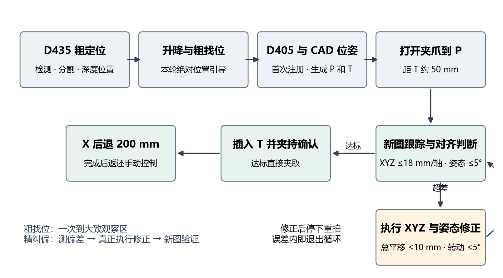

本说明面向现场操作与后续维护，覆盖从 D435 发现电池，到右臂接近、视觉纠偏、夹取和沿基座 X 轴后退 200 mm 的完整流程，并逐项说明自动抓取二级页面的功能。

说明以 Ubuntu 当前部署代码 `92e780f4d30f0241b2517a865638d1022e35945c` 和已保存任务记录为依据。软件已记录一轮完整流程到达 `CARRY_READY`。这表示流程获得了夹持和抽出完成回执；夹持判断主要来自夹爪反馈，不等于已经验证所有摆放方式或长期搬运可靠性。

# 1 快速使用

## 1.1 进入自动抓取页面

打开控制台 <http://192.168.58.14:9983/>，在 D405 相机卡片下点击“自动抓取链路预览”；也可直接打开 <http://192.168.58.14:9983/grasp-integration.html>。虽然入口名称带“预览”，这个二级页面已经包含实机自动流程的启动与停止功能。

## 1.2 设置并启动

1. 先确认 D435、D405 实时画面的时间在更新，电池和夹取通道可见。彩色画面更新只说明彩色流正常，RGB-D 定位还需要本轮可用的深度数据。
2. 到页面下方“实机自动流程”，设置“升降目标”和“右臂预观察 Z”。当前默认分别为 **5.52 rad、700.5 mm**；一般可先保持默认。
3. 升降按目标值向下取整作为到达门槛，例如输入 5.52，达到 5.0 rad 即可接受；输入 6.6，达到 6.0 rad 即可接受。这个输入是升降关节读数，不是高度米数。
4. 确认右臂、升降与夹取通道无人且没有临时障碍后，勾选现场确认框。执行后端可用时，“开始实机流程”才可点击。
5. 点击一次“开始实机流程”。运行中两个输入框和启动按钮禁用，自动任务取得运动控制权；通过上方本轮结果和下方日志查看进度。
6. 正常结束应显示“本轮完成”，并记录抽出电池的步骤。正常清理后控制权返还 9983，可回主控制台手动操作。

## 1.3 停止与再次运行

点击“停止自动任务”提交取消请求，等待页面显示“本轮已停止”和控制权处理结果。正常中止或结束会释放控制权；如果清理失败，系统会保留控制权并给出恢复状态，需要先检查。

“返回控制台”只是导航，不会取消自动任务。刷新、关闭二级页面也不能代替停止按钮。中止后不要把“重新开始”理解为从断点继续；新任务会重新开始识别和规划。

\newpage

# 2 完整链路与功能

{width=6.25in}

| 阶段 | 执行内容 | 得到的结果 |
|---|---|---|
| D435 粗定位 | 本地检测、SAM2 分割、深度定位 | 本轮电池可见表面在基座坐标系的位置 |
| 升降与粗找位 | 升降到配置目标；D435 位置结合 D405 标定计算观察位 | 右臂一次移动到大致可观察区域 |
| D405 精定位 | 获取新的冻结 RGB-D 图像并关联同一电池 | 更近距离的目标掩膜和深度位置 |
| FoundationPose | 首次注册电池 CAD 位姿，生成点云与参考路径 | 电池六自由度位姿以及 TCP 预抓点和终点 |
| 张开夹爪与接近 | 打开夹爪，移动到预抓点 P | 为末端纠偏和插入留出约 50 mm |
| 视觉精纠偏 | 停下后用新图跟踪，比较 XYZ 与姿态误差 | 超差则移动修正；达标则直接进入抓取 |
| 插入与夹取 | TCP 沿电池抓取方向到达 T，随后闭爪 | 插入运动与夹爪执行回执 |
| 夹持确认 | 检查新鲜夹爪反馈及目标关联 | `HOLD_CONFIRMED` |
| 抽出电池 | 当前腕位的基座 X 坐标减去 200 mm | `CARRY_READY`，完成后释放控制权 |

自动流程由固定工具顺序组织。Qwen 只在视觉存在歧义时参与判断，并不自行生成或直接下发机械臂运动指令。

当前功能还包括：本轮图像和工具输出展示、点云交互查看、任务内模型保留、运动回执轮询、停止任务、结束后的控制权返还，以及 D405 没找到目标时的原有上下观察搜索。

\newpage

# 3 粗找位与自动纠偏

## CYB 已验证门控 不得擅自删除

**CYB 提示：下列为用户确认已验证、要求保留的容差和验收规则。后续维护不得因为排查中止原因而擅自删除；修改必须取得用户明确指示。** 这是用户确认的保留要求，不表示本文编写时重新进行了全部实机验证。

| 需要保留的规则 | 用户设定 |
|---|---|
| 预抓后 XYZ 完成判断 | 每轴绝对误差 ≤18 mm，三轴同时满足 |
| 预抓后姿态完成判断 | 整体姿态误差 ≤5°；位置也达标即直接夹取 |
| 夹爪 J6 名义方向 | −90° ±6° |
| 电池方向兼容检查 | 10° |
| 升降到达验收 | 输入目标向下取整作为接受门槛，例如 6.6 → 6.0 rad |
| 抽出完成验收 | 沿用每轴 18 mm、姿态 5°，不另加更苛刻验收 |

**同时保留已确认的纠偏动作设置：单次三维总平移最多 10 mm、单次转动最多 5°；它们是动作步长，不是完成容差。** 其余未列入本表的后台检查，只在参数章节如实列明，不自动冠以 CYB 已验证标记。

\newpage

## 3.1 预观察阶段的大致找位

粗找位使用**本轮 D435 看见的绝对位置**，不依赖上一次电池摆放位置，也不需要比较两轮“移动了多少”。D435 得到的是可见表面位置，因此用于引导 D405 观察，不直接用作夹指尖的抓取终点。

系统结合 D405 与腕部的手眼标定，寻找从基座 X 方向能够观察该位置的腕位；优先使用页面设置的观察 Z 高度和既定观察姿态。初始阶段以一次连续运动到达大致观察区，随后交给 D405 和预抓后精纠偏。这里没有新增要求把电池粗位置对到 0.1 mm 的验收。

若 D405 明确返回未找到电池，原有上下搜索仍可使用。以粗找位完成后的实测腕位为起点，观察偏移顺序为 **+10、+20、+30、+40、0、−10、−20、−30 mm**。这些是相对同一起点的目标偏移；从 +40 回到 0 的那一步实际下降 40 mm。尚未把这套搜索扩大为 ±100 mm 或三维逐步搜索。

## 3.2 预抓后的 XYZ 和姿态精纠偏

预抓到位后重新拍照，通过跟踪更新电池 CAD 位姿，计算新的预抓目标，再与当前实际 TCP 比较。修正对齐的是**由电池位姿确定的夹取线段及夹爪目标姿态**，不是只抬 Z，也不是只让图像中心重合。

| 项目 | 当前设置 | 含义 |
|---|---|---|
| XYZ 完成容差 | 每轴 18 mm | X、Y、Z 分别取绝对值比较 |
| 姿态完成容差 | 5° | 当前 TCP 与目标姿态之间的整体旋转角 |
| 单次平移 | 三维总距离最多 10 mm | 不是每个轴各走 10 mm |
| 单次转动 | 最多 5° | 与本轮平移一起分步执行 |

判断规则：**XYZ 三轴都不超过 18 mm，且姿态不超过 5°，就认为已经对准，直接插入夹取。** 超出任一项时，沿新的目标方向平移最多 10 mm，同时分步修正姿态；执行后停下、重新拍照、再次判断。

例如误差为 X 20、Y 0、Z 0 mm 时需要纠偏；X 17、Y 17、Z 17 mm 且姿态 4° 时已经达标，因为位置采用每轴容差，而非三维总误差 18 mm。若位置已达标但姿态为 7°，仍会进入纠偏分支，平移和转动按当前误差计算。

已取消预抓后累计“只能观察 3 次”的限制，以及原来的小次数纠偏限制。没有要求把误差不断压到零；达到容差就结束纠偏。取消任务、反馈失效、执行超时、不可达或规划失败等真实异常仍会结束本轮。初始识别与单次视觉重试仍有各自预算，不能理解为所有阶段无限重试。

\newpage

# 4 视觉识别与目标跟踪

## 4.1 各模型的职责

Grounding-DINO 提供电池候选框；SAM2 根据候选生成目标掩膜；RGB-D 深度将掩膜中的可用点转换为三维表面位置。FoundationPose 将已知电池 CAD 与观测匹配，估计 CAD 在相机及基座中的位置和姿态。Qwen 在本地结果不能明确选择时，补充目标语义复核。

同一电池的整体框与局部框可能同时出现。当前先结合掩膜覆盖关系和深度位置合并去重，优先保留更完整的同物体结果，避免把一块电池误算成两个目标。

## 4.2 本地选择与 Qwen 触发条件

| 判断项 | 当前逻辑 |
|---|---|
| 检测与分割 | DINO 分数至少 0.30，SAM2 分数至少 0.85，并有有效深度定位 |
| 同物体去重 | 框有交叠，掩膜交集达到较小掩膜的 90%，表面中心相距小于 40 mm 时合并 |
| 首次 D405 目标关联 | 结合 D435 粗位置，采用 120 mm 关联范围 |
| D405 多候选歧义 | 两个有效候选与粗位置的距离差小于 40 mm，进入复核 |
| 无粗位置的候选歧义 | 前两名 DINO 分数差小于 0.10，进入复核 |
| 低质量或跟踪失效 | 不能凭有效本地结果唯一选择时，按视觉恢复路径处理，必要时调用 Qwen |

这些条件是当前视觉选择逻辑，不是文档新增的运动限制。DINO 与 SAM2 分数不是同一种分数，也不能直接读成“抓取成功概率”。Qwen 的 `parallel_tool_calls` 接口参数兼容已修复。

## 4.3 为什么预抓后还要看一次

第一轮精定位用于计算预抓点；机械臂移动后，相机位置、遮挡、执行误差和视角会变化，因此必须使用**移动后的新图**验证实际对齐情况，不能把运动前图像当作运动后状态。

后续不必每次重新做全局识别：跟踪有效时，系统使用已确认目标的投影框和 SAM2 更新掩膜，FoundationPose 用上一轮位姿作为初值执行 `track_one/refine`。首次才执行完整 `register`。如果跟踪失效，仍需要恢复目标定位。

模型在同一自动任务内按需加载并保留，后续观察复用；整轮结束或中止后关闭任务感知会话。这里的跟踪是“运动结束后取新帧并更新”，尚不是机械臂运动中逐视频帧连续闭环控制。

\newpage

# 5 TCP 目标与夹取抽出

## 5.1 F G T P 各是什么点

| 点或坐标 | 定义及用途 |
|---|---|
| F | 电池 CAD 的前部参考点，用于解释插入深度 |
| G | 旧 CAD 抓取参考点，保留作几何参考；不再作为 TCP 运动终点 |
| T | 提手孔附近的目标夹持位置，当前 TCP 最终到达这里 |
| P | 预抓点，位于 T 沿插入反方向约 50 mm 的位置 |
| TCP | 按当前操作约定，为标定得到的夹指尖；与腕部有固定标定变换 |

FoundationPose 估计的是整个电池 CAD 的位姿。F、G、T 是 CAD/抓取几何中预先定义的参考点，通过该位姿转换到基座坐标；它们不是 FoundationPose 分别识别出的三个视觉关键点。

在 CAD 原生插入方向上，G 距 F 约 9.27 mm，T 距 F 约 26 mm，两者相差约 16.73 mm。当前目标线段是 **P → T**，预抓与纠偏目标同步围绕 T 计算。G 仍在参考数据中，不参与给 TCP 额外扣一段偏移。

机械臂实际控制的是腕部，所以还要根据完整的腕部到 TCP 标定，反算腕部目标。当前标定 ID 为 `right-grip-pivot-16-20261112`，腕部到 TCP 的平移约为 `[148.142, 0.181, −1.143] mm`，并同时使用标定旋转。

## 5.2 插入与夹持确认

预抓后达到精纠偏容差，执行沿电池插入轴的路径，到 T 后闭合夹爪。当前张开目标为原始关节值约 −3.14，闭合目标约 −0.4。原始值是夹爪控制读数，不是毫米开口。

夹持确认使用新鲜夹爪反馈，要求反馈进入配置的持物区间 `[-1.5, −0.5]`，并与本轮目标关联。夹爪有物体阻挡时不必达到空夹闭合目标 −0.4 才算持物。当前确认没有独立的视觉持物检测或力传感器判定。

## 5.3 夹取后沿基座 X 后退 200 mm

确认夹持后，读取当时实测腕位，设置目标：**X 新值 = 当前 X − 200 mm；Y、Z 和姿态目标沿用当前值**，保持夹爪闭合。姿态保持时，TCP 与腕部的 X 位移相同。

这一段复用 9983 手动末端位置控制接口，完成判断沿用每轴 18 mm、整体姿态 5°，没有新增更严格的静止速度验收。它是末端点位命令，不能写成整段每个瞬间 Y/Z 都严格恒定的笛卡尔直线伺服。最终以到位容差完成，不能把目标 200 mm 写成精确实测 200 mm。

工具内部名仍叫 `stow_for_carry`，当前含义只是后退抽出，不包含收臂、导航、移动底盘或把电池运到另一位置。

\newpage

# 6 二级页面各部分怎么用

以下按页面从上到下排列。上半部分展示的识别、位姿、点云和路径，都取自下方启动的同一个自动任务，不再是另一套独立识别按钮。

## 6.1 顶部与相机区域

| 页面区域 | 显示什么 | 使用方法与判断 |
|---|---|---|
| 返回控制台 | 回到 9983 主页面的链接 | 用于切换页面，不会停止自动任务 |
| 自动抓取实时结果及任务编号 | 当前 `run_id` 与流程阶段 | 排查时记下编号，确认看到的是哪一轮 |
| 标题下状态行 | 结果接口读取状态或错误 | `Failed to fetch` 表示页面请求失败，单凭此行不能断言机械臂已经停止 |
| D435 实时画面 | 广角彩色相机最新画面及时间 | 看电池是否在视野、场地是否变化；页面约每 0.5 秒读取一次画面元数据 |
| D405 实时画面 | 腕部相机最新彩色画面及时间 | 看接近过程、遮挡和当前观察角度；图像实时更新不代表正在执行新一轮识别 |
| D435 本轮识别结果 | 这轮粗定位使用的分割叠加图 | 看选中的是否是目标电池；下方坐标是可见表面位置，不是 T 点 |
| D435 结果下的粗对位状态 | 本轮升降目标、预观察腕位 XYZ | 用于核对两个设置值及 D435 引导后的观察目标 |
| D405 本轮识别结果 | 本轮最近一次精定位/跟踪的掩膜叠加与表面位置 | 看跟踪对象是否正确；动作后的新识别完成才会更新 |

实时画面与本轮结果可以不同：实时画面是现在看到的画面；识别叠加是工具处理过的冻结观测。不要把两者的时间或坐标混用。

## 6.2 FoundationPose 位姿结果

“FoundationPose · 本轮位姿结果”显示电池 CAD 和提手参考几何叠加图。用于观察估计的方向是否贴合真实电池，尤其是电池歪放时的插入轴与目标姿态。

图下方“位姿表面核对”包括状态、深度中位误差、P90 误差和掩膜覆盖率。中位误差反映典型深度残差；P90 表示约 90% 样本误差落在该值以内；覆盖率表示匹配表面对目标掩膜的覆盖情况。它们反映位姿和观测的一致性，不等于 TCP 实际定位误差。

显示“等待本轮 FoundationPose 输出”，意味着这个任务尚未产生对应结果；不能只根据实时画面已有电池就推断位姿估计已完成。

\newpage

# 7 点云 工具结果与操作区域

## 7.1 本轮点云与抓取参考路径

三维窗口显示当前冻结观测生成的电池点云及 TCP 目标线段。青色线段起点是预抓点 P，橙色终点是 T。点云颜色来自观测数据。鼠标拖动可旋转，滚轮缩放，按 OrbitControls 的鼠标操作平移视角；“重置视角”把视图重新对准当前路径终点。

点云只在工具完成新观测后更新，不会跟随上方视频逐帧变化。这里展示目标几何，不是机械臂整机 CAD 动画，也不是所有关节路径的完整碰撞检查画面。WebGL 不可用时仍可查看图像和数值。

## 7.2 抓取计划与工具结果

| 显示项 | 功能 |
|---|---|
| 冻结观测编号和时间 | 识别这份点云/路径来自哪次拍摄 |
| TCP 预抓点与 TCP 终点 | 基座坐标系中的 P 和 T，单位 mm |
| 预抓腕位与夹持腕位 | 根据 TCP 标定反算的腕部位置；与 TCP 坐标不是同一个点 |
| TCP 标定 ID | 本轮规划实际引用的标定记录 |
| 计划提示文字 | 提示点云已生成、TCP 已加载等进度；不是实机到位证明 |
| 按序列出的工具条目 | 点击每条左侧展开箭头，查看该工具返回的 JSON 数据 |

工具条目包括“电池识别与深度定位”“升降与预观察计划”“升降与预观察执行”“FoundationPose 与点云”“抓取路径规划”“张开夹爪与接近”“插入与夹取”“夹持确认”“沿 X 后退 200 mm 抽出电池”。纠偏时识别、位姿与规划条目会重复出现。

“抓取路径规划 · 完成”只表示规划工具返回成功。是否已对齐，应看返回的 `refinement.status`；是否真正执行完成，应看运动回执和后续阶段。`aligned` 表示误差内，`correction_required` 表示要执行修正。

## 7.3 实机自动流程

“升降目标”输入范围为 1～18 rad，步长 0.01；“右臂预观察 Z”输入范围为 0～1500 mm，步长 0.1。浏览器输入范围不是所有数值都能实机到达的承诺。预观察 Z 是粗观察高度偏好，不是最终抓取高度；抓取高度由视觉和几何规划决定。

现场确认框配合执行后端状态决定启动按钮是否可用。“停止自动任务”仅在任务运行时启用。运行中输入框禁用，本轮参数不在中途更改。页面首次读取后端设置时会填入返回值，运行前应核对显示内容。

按钮右侧显示等待、执行中、完成、需要检查、已停止等状态和原因。下方“实时执行日志”按时间显示建立任务、路径检查、下发请求、工具回执、视觉重试、流程结束与控制权处理；日志可滚动，查看失败前后完整顺序。

\newpage

# 8 运动设置与控制权

## 8.1 当前关键参数

| 参数 | 当前值 | 应如何理解 |
|---|---|---|
| 关节规划速度上限 | 六轴各 8.55°/s | 自动定时轨迹的规划限制 |
| 关节规划加速度上限 | 六轴各 18°/s² | 平滑起停的规划限制 |
| TCP 规划速度上限 | 30 mm/s | 夹指尖沿路径运动的速度限制 |
| TCP 规划加速度上限 | 60 mm/s² | 夹指尖速度变化的限制 |
| 预抓距离 | 50 mm | P 到 T 的插入方向距离 |
| 预抓后完成容差 | 18 mm/轴，姿态 5° | 达标直接抓取 |
| 纠偏步长 | 总平移 ≤10 mm，转动 ≤5° | 每轮修正后的重新观察 |
| J6 名义方向检查 | −90° ±6° | 单独的夹爪关节约定，不是视觉姿态容差 |
| 电池方向兼容检查 | 10° | 夹爪和电池几何方向的规划检查 |
| 插入线规划偏离上界 | 2 mm | 关节插值轨迹的计算界限，不是实测误差 |
| 插入轨迹姿态偏离 | 0.7° | 路径途中相对计划姿态的偏离，不是视觉容差 |
| 抽出目标及到位容差 | X −200 mm；18 mm/轴，5° | 复用手动腕位接口与已有宽松验收 |

上述定时速度用于自动粗调、接近、纠偏与插入等规划轨迹；最终抽出复用手动 `arm.wrist` 点位接口，使用该手动通道的执行方式，不能据此声称抽出也严格按 30 mm/s 定时轨迹运行。规划上限也不代表每一瞬间达到上限。

不同阶段的检查含义不同：18 mm/轴和 5°用于判断视觉对齐是否足够；插入执行器还有自己的反馈到位设置；2 mm 与 0.7°检查计划路径形状。它们不是叠加成一个统一的视觉精度要求。

## 8.2 谁拥有控制权

自动流程运行时独占相应运动控制权，避免手动与自动同时下发右臂/升降命令。正常完成、中止或取消后会进行执行清理并尝试释放，正常结果应出现“控制权已返还手动控制”。

若释放被拒绝，后端会设置恢复标记并保留控制权，而不是表面显示空闲后允许两条运动互相覆盖。此时应看控制权处理日志与未决回执，不能仅通过重复点击启动解决。

系统对已提交的运动保留请求和回执。结果不明时先查询原请求，不自动重放未知结果的实机运动。释放控制权是软件权限状态，不独立证明所有硬件已经物理静止。

\newpage

# 9 日志怎么看与异常处理

## 9.1 先定位任务 再定位失败阶段

记录页面右上角 `run_id`、结束时间、最后一个成功工具和第一个失败工具。展开“工具结果”读取细节，并结合实时日志中的下发和回执顺序，避免只看最终一句报错。

| 现象或字段 | 含义及检查重点 |
|---|---|
| `execution_unknown` 刚出现在下发后 | 可能只是异步执行尚未结束；继续看原请求的 `get_execution_status` 和最终流程状态 |
| `Existing motion receipt requires recovery` | 原运动结果需要恢复确认，流程不会自动重放 |
| `pick_plan_failed` | 规划阶段被拒绝，可能尚未执行接近；看内部具体原因 |
| `feedback_invalid` / 反馈失败 | 执行阶段没有得到可接受的新鲜反馈；查看是哪一个动作、是否已经发出停止请求 |
| `needs_attention` | 本轮停止，需要根据具体原因检查；不是统一的“识别失败” |
| `Failed to fetch` | 浏览器请求未成功；相机接口、任务状态和结果接口可能分别正常或异常 |
| 任务结束但仍提示自动占用 | 核对释放日志、恢复标记和未决执行状态，不把旧网页文案当成唯一依据 |

点击停止后，流程会请求停止并处理已有执行；不会为了恢复而自动张开夹爪。拿着电池时，停止任务也不意味着可以忽略电池当前是否仍被支撑。

## 9.2 已有的碰撞检查范围

现有路径检查使用机械臂 CAD 网格与配置中的固定基座/中央立柱几何，并结合关节路径检查。此前“包围盒间隙减保守量后必须大于 20 mm”的误拒路径已改掉。页面的电池点云预览与后台机械臂 CAD 检查是两件事。

当前检查范围不能直接等同于完整场景碰撞检测：不代表已覆盖所有临时物品、人体、整架无人机、电池被夹持后的扫掠体积及任意自碰撞场景。现场确认与可达路径仍需符合本轮实际布置。

\newpage

# 10 已有运行证据

本次核对的完整成功任务为 `run-20261113T011613Z-83ee3ca2`，时间按香港时区记录，约从 **09:16:13 到 09:18:00**。最终状态为 `completed`，任务阶段为 `CARRY_READY`，流程处于 `extract` 完成。

| 保存记录 | 已确认内容 |
|---|---|
| 粗对位执行 | 获得完成回执，升降接受读数约 5.074 rad |
| 预抓执行 | 张开夹爪与接近完成，要求新的观察 |
| 预抓后对齐判断 | XYZ 误差 −0.93 / +7.38 / −2.98 mm，姿态 4.80°，判定 `aligned` |
| 插入与夹爪 | 获得到位及夹爪执行完成回执，随后夹持确认通过 |
| 最后抽出 | `extracted=true`、`carry_ready=true`，目标腕位约 312.9 / −198.9 / 704.8 mm |

这轮误差本来就在容差内，因此没有额外执行超差纠偏动作。它证明本轮“检查达标后直接夹取”和完整抽出流程获得软件回执，不能用来声称这一轮实际执行过 XYZ 与姿态修正，也不能据此推断所有大偏差都已实机验证。

该轮首个 D405 观察约 1.71 秒，首次 FoundationPose 约 9.99 秒；预抓后的 D405 观察约 1.09 秒，FoundationPose 跟踪约 1.01 秒。抽出从请求到完成回执约 9.45 秒。这些是保存记录的时间间隔，包含相应调用和等待开销，不是每轮性能保证或纯电机运动时间。

\newpage

# 11 维护定位与使用边界

## 11.1 当前源码位置

部署目录：`/home/arx/arx-competition-control`。下表路径均相对此目录。

| 文件或目录 | 负责内容 |
|---|---|
| `web/public/grasp-integration.html` | 二级页面结构、设置框、启动停止入口 |
| `web/public/js/grasp-integration.js` | 相机轮询、同轮输出、点云、工具展开、操作请求 |
| `web/src/battery_task.py` | 网页任务会话、控制权、结束清理与结果输出 |
| `agent/battery_flow.py` | 固定自动流程顺序、回执轮询、结束感知会话 |
| `agent/coarse_alignment.py`、`agent/observer_pose.py` | 升降与 D435 引导观察位 |
| `agent/perception_worker.py`、`agent/perception_session.py` | 本地选择、去重、跟踪、任务模型复用 |
| `foundationpose/infer_snapshot.py` | FoundationPose 注册及跟踪 |
| `agent/grasp_geometry.py`、`foundationpose/battery_grip.py` | CAD 参考点转换和 TCP 目标线段 |
| `agent/grasp_refinement.py` | 每轴 18 mm、姿态 5°判断及 10 mm/5°修正步 |
| `agent/battery_pick_plan.py`、`agent/grasp_path.py` | 腕位反算、IK、插入/纠偏轨迹与时间规划 |
| `agent/battery_extract.py` | 夹持确认后腕位 X 减 200 mm |
| `web/src/control.py`、`web/src/handeye_column.py` | 手动末端接口、运动提交、CAD 立柱检查 |
| `config/battery-execution.json` | 自动流程速度、超时、精纠偏等参数 |
| `config/right-grip-tcp.json` | 腕部到 TCP 的标定 |
| `web/public/cad/battery-grip.json` | 电池 CAD 中 F/G/T 参考几何 |
| `agent/runs/<run_id>/` | 状态、事件、观测、预览、计划和执行回执 |

共享本地视觉实现还位于 `/home/arx/arx-vision-demo/vision/demo/`。维护时需要区分自动流程仓库与共享模型实现，不应只检查一个页面文件就认定整个视觉链路未变。

## 11.2 尚未覆盖的能力

当前支持 XYZ 与姿态的分步视觉精纠偏，支持 D435 引导粗观察位，支持夹持确认后的 200 mm 抽出。尚不能将其描述为运动中连续视觉伺服、独立视觉持物确认、完整场景防碰撞、自动收纳搬运或任意初始摆放都能成功。

升降输入主要用于现有向上到达目标的工作方式；不应把设置框理解成任意起始高度下自动上下搜索的通用升降控制器。遇到目标不可达、跟踪丢失或反馈异常，需要查看具体阶段日志。
