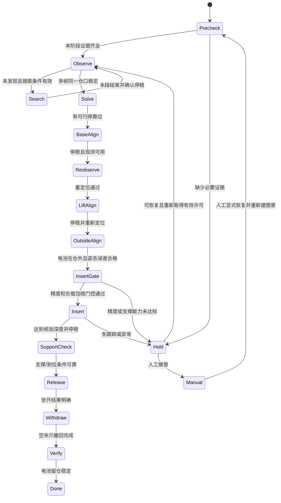

# 局部自主找仓、底盘/升降对位与电池入仓设计

状态：已确认设计；RGB夹持监测、阶段门控与模拟流程已离线实现，实机执行未接通。2026-11-15。详见 `docs/held-docking-offline.md`；本文仍包含后续硬件集成与实物验收要求。

用户已选择：当前位置附近搜索与对位。继承上一轮“不做实机”约束，本轮只核对源码、编写设计与验收用例；不发送控制、开启节点或切换在线服务。原工程不改，不推送。

## 1. 目标与范围

电池已可靠夹持时，系统在限定范围内自主识别红框电池仓，选择有足够机械臂可达余量、碰撞余量和定位证据的底盘位置与升降高度。先在仓外完成对齐，再冻结底盘、升降和入仓世界Z，沿仓口左侧水平插入。正常阶段凭机器证据自动推进，短暂可恢复的观测问题在限定预算内自我修正。人工停止优先且保持锁存，停止结果不明时不自动恢复，不重复松爪。

“尽可能自动化”是用可核验的证据替代重复确认，不是把缺失证据改成通过。设计必须区分：识别成功、可以搜索、可以粗对位、可以入仓、可以松爪、可以恢复，不能用一个总开关代表全部能力。

范围不含：跨区域地图导航、在线猜测标定、自动回零/重新校准、用接触试探扩大孔洞、无力反馈条件下盲目推入、自动解除急停、自动取消人工接管、带物重启驱动。全局地图导航作为后续独立模块，不成为局部对位的隐含依赖。

## 2. 已核对的现有能力与缺口

| 源码/资料 | 当前行为 | 对本设计的约束 |
|---|---|---|
| `web/src/server.py:326` | CompetitionTask 仅注册 pick；导航、运输、放置未接入 | 不能把整场任务页面当作自主放置已经打通 |
| `web/src/placement_task.py:43`、`agent/placement_backend.py:85` | 旧放置面向红圈支撑面，持物阶段固定升降 | 新建仓口模块，不改成复用旧下降松爪流程 |
| `web/src/cabinet_preview.py` | D435主定位、RGB/CAD PnP、原TCP与固定Z几何预览；执行关闭 | 复用感知与来源校验，不将预览结果直接下发 |
| `web/src/control.py:76–125` | 进程内独占token，外部停止锁存；一般人工运动被拒绝 | 新增明确的“请求接管→停稳→交还控制”，拒绝运动不能代替识别接管意图 |
| `web/src/control.py:262–316`、`release_motion` | 常规arm.stop/lift.stop/chassis.stop仍经过反馈/就绪等门控；释放token自身不证明实测静止 | 建立独立停止通道与停稳凭证，不能只包装现有submit(stop) |
| `web/hardware/command_lease.hpp:7–14` | Web停止优先；Web租约期间Gamepad停止可能被拒绝 | 必须补跨来源停止/接管仲裁，不能宣称目前手柄可随时接管 |
| `web/hardware/lift_controller_web.cpp:83–109`、`chassis_motion.hpp` | 旧网页与SDK通道单位不同；SDK加速度常量明确不是SI物理量 | 自主底盘须有经核验的SI适配与停止距离；禁止沿用UI数值作为m/s或rad/s |
| `web/src/navigation_view.py:84–110` | 提供地图TF与时效标记，未给出控制级定位误差界与实测速度证据 | 地图显示有效不等于可据此精确控制或确认停稳 |
| `navigation/README.md` | Nav2适配默认仅输出/navigation/cmd_vel，未说明完成实车桥接验收 | 不自动启动Nav2或假定已打通执行 |
| 主机当前交付URDF（只读核对） | D435固定于head_113_link，该link固定到base_link；joint4单独驱动body4 | 升降用于机械臂高度，不会改变D435视野；D405随右腕运动 |
| `config/right-grip-tcp.json` | 既有位置标定RMS 3.1207mm、样本最大残差4.1811mm，旋转为名义CAD轴 | 保留TCP；这些残差不能作为窄仓口精度已合格的证据 |
| `vision/handeye/results/d435-cad-349622074226.json` | 相机到基座外参为名义CAD，精度未实测 | 可以离线几何预览，不能自动把绝对基座坐标当作毫米级验收 |

以上是本次源码和URDF检查结果，不代表本次实车状态或现场标定结果。

## 3. 方案选择

采用用户选择的局部视觉闭环方案：围绕当前位置限定搜索，先底盘停走对位，再升降停走对位，再机械臂仓外精对位。每段后重新观测，避免同时移动多个机构导致外参与持物关系难以解释。

未采用的方案：

- 先接全局地图任务：会引入地图、定位和跨区域障碍验收，超过当前选择范围。
- 一次估计后同时移动底盘、升降和机械臂：依赖当前尚未证明的外参、速度换算和持物模型，不利于判定纠偏原因与安全停止。

后续可在分别验收后合并运动，但第一版不并行驱动这些自由度。

## 4. 状态机与动作顺序

所有阶段都允许转入Stopping。Stopping必须先禁止新段和新松爪，再发送停止/保持请求，等待实测停稳。急停、停止失败、执行结果不明、疑似接触、夹持失效进入RecoveryRequired；没有新鲜证据不能直接回Observe。图中的Hold→Observe只适用于白名单内可恢复事件，不包括人工停止/接管。

搜索不是原地自由旋转。携物搜索先检查两臂、电池、夹爪扫掠、底盘足迹、桌边/立柱/线缆可观测范围。目标丢失时，先停住，再决定能否改变观察位。已有部分入仓时，禁止用底盘或升降“找回目标”。

## 5. 局部搜索与停靠位求解

### 5.1 有界区域

设计候选默认值（仅供离线场景，不是实机许可）：相对起点平移半径0.30m、偏航范围±15°，累计平移不超过0.60m、累计绝对旋转不超过30°，最多7个观测位、3次纠偏循环。半径限制与累计路程限制同时生效；回到起点不清零预算。具体物理速度、制动距离、单段时长与最小障碍距离必须来自校验过的场地/设备配置；缺失即拒绝实机动作，不提供猜测默认速度。

可先等待新画面、调整图像曝光或重做识别。这些无运动修正也有次数与时间上限。底盘搜索应优先选择预计信息增益高、无需靠近仓口、且携物扫掠最短的观察位。升降不用于改变D435视角，也不自动回零。

### 5.2 识别与身份

复用红色闭环与CAD PnP，至少要求多个不同曝光时间的观测支持同一个目标，不能重复使用缓存帧凑票。目标身份绑定演示仓或比赛上排中间仓、红框轨迹、仓口模型与版本。PnP多解应保留并检验跨视角一致性；目标不唯一时不按“最红/最大”自行换目标。D405允许只看电池/夹持或局部边，不能因缺少完整红框阻断正常辅助，也不能覆盖D435目标。

D405另承担电池夹持状态监测：判断是否夹到、夹持区域是否正确、可观测姿态是否合格及是否相对滑移，作为G09的独立证据。它可以不看全仓口或整块电池，但必须看得到所判维度的关键特征；不能仅凭夹爪位置、历史抓取成功或当前稳定图像判“可靠持物”。详见 `docs/d405-held-battery-design.md`。

动态画面只用于跟踪和减速/停车判据；每次决定下一运动段前，要在停稳后取得用于精确定位的新帧。若D435同时看得见电池特征和仓口，可使用相对视觉误差减少共同外参偏差；仍须验证尺度、姿态、遮挡与实际误差界，不能把像素误差直接写成毫米精度。

### 5.3 候选变量与约束

求解变量包括：底盘SE(2)停靠位、升降高度、机械臂仓外位姿、左侧允许范围内的电池中心与入仓轴。候选优先最大化全负载路径最小净距、关节余量和数值条件，再减少底盘移动、升降变化和高位携物距离。不是机械臂刚好够到就算停靠成功。

每个候选至少验证：

- 底盘足迹、两臂、夹爪、电池与固定障碍的全程扫掠；升降检查两臂和持物的整个高度区间。
- 当前实际起姿到仓外位姿及撤回路径可达；避免关节限位、奇异区和不可恢复姿态。
- 左侧目标与为另一块电池预留的空间；可在左侧允许区域内优化净距，不强制永远取四分之一点。
- 入仓段固定世界Z和姿态；底盘、升降冻结，不能在段中用它们补偿误差。
- 升降以同一回零纪元、经过验证的零点/比例/方向换算；41.54rad/m只是现有名义系数，不能代替实测精度证书。遵守现场软件上限与止挡余量，不冲最高点。
- 移动后相机视野、识别质量、退路、保持电池的能力。高位携物稳定性与制动参数缺失时拒绝底盘移动。

净距检查还必须覆盖从每个中间状态触发停止后的可达包络，而不只是正常参考轨迹。将故障检测时间、监督周期、命令传输/排队延迟、各机构停止过程、跟踪误差和负载摆动的经验证界限计入。底盘搜索边界与累计预算也保留停止余量；机械臂/升降不得因“下一段很短”忽略停止后继续运动的距离。正常轨迹清楚但任一点的停止包络可能碰仓口/障碍时，拒绝该候选或减小段长、降低已验证的速度；停止模型缺失时不批准运动。

底盘动作后使用里程计/视觉实际位移验证到位，不能用发送速度×时间当作实测位移。每次升降与底盘调整后都重新计算实际FK与目标，禁止沿用动作前基座坐标。

### 5.4 坐标与固定Z的定义

使用本轮固定、与重力对齐的局部坐标系local_gravity，不要求先有全局地图。坐标链为：`T_local_from_base × T_base_from_camera`定位仓口；`T_local_from_base × FK_base_from_wrist(q,lift) × T_wrist_from_grip × T_grip_from_battery`重建电池。所有输入有同一时间基准或明确的插值/时延界，变换纪元和单位要绑定到段许可。

当前几何预览的frame是base_link，不能在存在底盘俯仰/横滚或地面坡度时直接声称固定世界Z。新模块必须明确检查局部重力方向与姿态时效；入仓固定的是local_gravity的Z，同时监测底盘平移、偏航、横滚和俯仰。缺少可靠姿态/坐标链时只提供模型预览，不批准入仓。

## 6. 门控目录

每项输出`verified|missing|stale|rejected|conflicting`，带证据ID、来源、曝光/反馈时间、坐标系、单位、版本hash、有效范围和失效原因。只有verified可通行，unknown不得等同通过。授权门和技术证据门分开。

| ID | 检查内容 | 所属阶段 | 未通过的处理 |
|---|---|---|---|
| G01 | 已授权本轮局部作业区、动作类型与预算；运行ID/启动纪元一致 | 全阶段 | 不启动/中断；不能由模型扩大区域 |
| G02 | 急停/驱动故障/底层看门狗状态明确 | 所有运动 | 锁存停止，不自动解除 |
| G03 | Web、自动任务、手柄与其他发布者控制权唯一 | 全阶段 | 停稳后接管；抢占不重试运动 |
| G04 | 反馈真实、有限、顺序递增、时效和配对达标 | 所有运动/停稳 | 停止并保持；不以缓存计稳态 |
| G05 | 仓口身份、模型、红框完整性与PnP歧义可接受 | 定位、对位、入仓 | 有界重观测；不换目标或补隐藏角 |
| G06 | 相机内外参、TCP、持物关系及坐标链有效 | 每段 | 相应动作拒绝；不自动重标定 |
| G07 | 底盘SI映射、方向、制动/停距与控制级里程计有效 | 搜索、底盘对位 | 拒绝底盘动作 |
| G08 | 当前负载下的底盘/双臂扫掠与障碍观测覆盖有效 | 搜索、底盘对位 | 保持；缺失点云不代表空旷 |
| G09 | D405关键夹持区、可观测姿态/滑移与夹爪反馈、抓取承载证据连续一致；不确定维度不填正常 | 携物全部阶段 | 停住；不自动加力、重置基准或重新抓取；释放后切换空爪证据合同 |
| G10 | 升降回零纪元、单位、上下限、保持和全程扫掠有效 | 升降 | 拒绝升降；禁止携物回零 |
| G11 | 机械臂IK、关节/速度/加速度限值、负载扫掠有效 | 仓外、入仓、撤回 | 有预算地重算候选；不夹紧或撞限位尝试 |
| G12 | 定位、夹持、跟踪综合误差上界小于可用净距 | 入仓前及每段 | 只允许重观测/仓外再对位，仍不足则停住 |
| G13 | 底盘、升降、非执行臂实测停稳并在允许漂移内 | 仓外精对位、入仓、松爪 | 终止当前段；不以目标速度为零代替 |
| G14 | 每段只执行一次；实际进度、命令回执与跟踪误差一致 | 所有动作 | 未知结果进入恢复；禁止重发旧段 |
| G15 | 支撑/到位深度与电池姿态满足已验证的松爪证据合同 | 松爪 | 保持夹持；不能用“夹爪到点”替代支撑 |
| G16 | 松爪结果明确且只执行一次，撤回路径有效 | 释放、撤回 | 未知结果锁存，不盲目再次开合 |
| G17 | 松爪后电池留仓稳定、空夹爪安全撤回 | 完成 | 不宣布完成，保留现场状态 |
| G18 | 搜索/纠偏预算、进展、超时与振荡检查通过 | 搜索、纠偏 | 达预算即保持并给出具体原因 |
| G19 | 进程/主机重启、网络、执行器心跳和未决记录一致 | 全阶段 | 绝不重放未决物理动作 |
| G20 | 人工停止/接管锁存清除必须有显式新恢复请求 | 停止后 | 自动恢复不可越过人工意图 |

门控是阶段相关的依赖图。G12未通过不能停止只读诊断，也不能让“搜索可用”解锁松爪。辅助相机部分遮挡不是全局硬故障。实施时使用下表，不把G01–G20全部套用到每个动作：

| 操作 | 必需条件 | 特别分支 |
|---|---|---|
| 只读图像、日志、驱动/急停状态诊断 | 读取权限、明确来源/时间/未知标注 | 急停、故障、人工停止锁存时仍允许；不得由读取推进运动 |
| 生成度量定位/预览 | G04、G05、G06达到相应预览级别 | 未标定时可保留2D检测或明确的名义模型预览；不授予运动许可 |
| 携物底盘搜索与停靠 | G01–G04、G06(本动作需要的坐标级别)、G07–G09、G13(起动前与非执行机构)、G14、G18–G20 | 不要求G05已经找到目标才能搜索；要求有效携物/停止包络与预算 |
| 升降对位 | G01–G04、G06、G08(升降扫掠覆盖)、G09–G10、G13(底盘与非执行机构)、G14、G18–G20 | 禁止部分入仓时升降；不得为恢复对位自动回零 |
| 仓外机械臂纠偏 | G01–G06、G08–G09、G11、G13–G14、G18–G20 | 精度级别为仓外级；插入精度不合格不阻止有独立净距证明的仓外纠偏 |
| 入仓段 | 仓外条件加G12的插入误差包络；底盘/升降冻结 | 每段需实际起姿、正常和停止包络、可靠持物关系；缺失即保持 |
| 部分入仓保持/失效停止 | 独立停止网关和本机经过验证的保持策略 | 不依赖G05/G12成功才能发停止；无法确认结果时不释放控制权 |
| 部分入仓有限撤回 | G01–G04、G06、G08–G09、G11、G13–G14、G18–G20，加独立撤回许可 | G05丢失可由仍有效的撤回走廊/仓体未变证据和当前位置界替代；G12用撤回不确定性包络，不要求重新满足插入对准。疑似接触、仓体移动、持物或当前位置不明时不得撤回 |
| 松爪 | 入仓后的实际到位与停稳证据、G09、G12、G13–G16，以及G01–G04/G06/G19–G20 | G15不成立就保留夹持；人工确认不能单独替代支撑证据 |
| 松爪后空爪撤回 | G01–G04、G06、G08、G11、G13–G14、G16、G18–G20；释放已明确且空爪包络有效 | 不要求“仍持物”的G09；需确认未夹连电池、退路有效。释放未知时不能选择本分支 |
| 完成 | G17并持有所有未决动作已解决的证据 | 不因夹爪张开或流程返回成功就宣布电池已放稳 |

入仓接合状态独立于视觉/调度阶段持久化为outside_verified、may_be_inserted、inside_verified、released_verified、disengaged_verified或unknown。在发出任何可能使电池前端越过仓口面的命令前，先落盘may_be_inserted，考虑定位误差界，不能用TCP是否越面代替电池前端。只有可靠证明已完全退出并保留余量，才可标记disengaged_verified。Hold、重识别、重新启动或切换候选不得清除此状态；在接合未排除前，禁止重走BaseAlign/LiftAlign，防止Hold→Observe绕回底盘/升降运动。

## 7. 精度与自动验收

当前CAD净口169.6×79mm、电池横截面约82.35×75mm。若左半区中心取四分之一点，最靠左外壁名义余量约1.225mm，上下各2mm；倾斜、圆角、夹爪与实际摆放还会改变余量。它不是可随意采用厘米级门限的插入任务。

粗对位采用宽容差，将目标送进机械臂有余量的工作区；仓外精对位采用更严格的视觉/几何误差界；入仓前根据当前全包络扫掠净距逐次计算允许误差；松爪再独立核验。不得为跨过门控在运行中不断放宽容差。

按仓口横向、竖向与旋转三个方向建立端到端误差包络，包含：仓口定位、尺寸/贴标、TCP、持物偏移、底盘/升降停稳漂移、机械臂跟踪、时延、入仓角度。角度误差须换算为电池远端偏移并纳入全路径检查。要求：

`误差包络 + 保留余量 < 本次路径的几何净距下界`

不能把统计RMS当作最坏误差界，也不能将相关误差当独立高斯量随意相加。使用有适用范围的端到端验证证书、可靠界限或经验证的相对视觉闭环能力。PnP重投影、多帧一致、实际FK残差可自动检查，但都不能单独证明实际电池与仓口毫米误差。

当前名义D435外参与既有TCP残差不足以证明窄仓口已满足该要求；因此第一版可以离线检验、识别与计算粗对位方案，不应声称已具备无需干预的实物插入资格。若精度达不到，系统应明确指出是哪项误差证据缺失；机械导向、放置布局或增加可观测特征是独立后续改造，不暗中改变本次任务。

## 8. 自我修正与恢复白名单

| 事件 | 自动允许的处理 | 不允许的处理 |
|---|---|---|
| 短时无新图、曝光不佳 | 等待新帧、有限重采样/识别，适当降低图像证据置信；有界超时 | 继续沿旧坐标运动 |
| 找不到框、存在姿态歧义 | 在已核验区域内选择下一个观察位；移动后停稳重测 | 把不完整红框补齐、带物自由绕圈 |
| 仓外误差可解释且下降 | 小步纠偏、重测，适当缩小步长；重新验算全负载路径 | 为了收敛扩大速度/力矩/限值 |
| 纠偏误差增大、符号反常或反复过冲 | 停止本段；在预算内重估模型或更换候选；连续两次无进展结束自动纠偏 | 不断加大控制量，重置累计预算 |
| 升降/关节卡滞、滑移、异常电流或疑似接触 | 保持并升级RecoveryRequired | 自动加力、继续推进或自动回零 |
| 入仓中目标遮挡/置信丢失 | 停止；只有当前状态可测且撤退包络仍成立时才允许已核验的有限撤回 | 入仓中移动底盘、升降或大角度搜索 |
| 人工停止、接管或急停 | 锁存；等实测停稳，展示交还状态 | 定时自动恢复、把手柄松开当作恢复 |
| 释放响应未知或重启发现inflight | 只读核对持物/留仓/执行器状态，保留未决记录 | 重放release、自动再次闭合、重新从起点执行 |

纠偏器为确定性受限优化器。语言模型最多解释日志或从已注册的恢复名称中建议一个；不得生成电机指令、扩大预算、改变目标、改门限或清除人工停止。所有恢复动作与正常动作经过同一门控及代次校验。

## 9. 人工接管、打断与网络

### 9.1 统一仲裁

控制意图优先级：物理急停/硬件故障 → 任意来源停止与人工接管请求 → 已授权人工控制 → 自动段。停止不受Web租约屏蔽；只有运动命令需要独占有效所有者。

Python token之外，需要执行网关/驱动统一确认来源、run_id、boot_id、control_generation、segment_id、单调序列与TTL。元数据应与命令原子关联，不能依赖两个独立话题碰巧配对。旧代次、迟到消息、重复段、过期TTL均拒绝。手柄绕过网页的路径也要进入仲裁和事件反馈，不能仅靠Python看关节漂移推测是否被人工操作。

接管过程：原子锁存禁止自动新段 → 请求所有相关机构停止/保持 → 用递增的新反馈确认实际停止 → 结束自动段并撤销许可 → 交还人工。停止失败或静止证据缺失时显示“停止未确认”，不能显示“可以人工控制”。不要因结束网页线程而失能升降或打开夹爪。

停止分发不得复用正常运动的前置门控：反馈失效、目标定位失效、配置切换或任务token失效不能成为“不发送停止”的理由。新增受权限约束但独立的停止网关，使用已验证的驱动停止/制动/保持接口；本机驱动看门狗独立生效。反馈丢失时不根据过期/缺失数据生成新的关节或升降目标，不退化成失能、零力矩或打开夹爪。某设备停止接口不可用或结果不明时，锁存停止未确认并升级恢复，不对外宣称已经安全停稳。

释放控制权必须消费同一停止代次下、停止请求之后获得的停稳凭证，覆盖底盘、升降和有关机械臂；仅服务返回成功或清空轨迹对象不够。凭证包含新反馈序列、时间窗、实际运动上界、模型与配置身份。新命令、驱动重启或状态异常立即使凭证失效。新模块、CompetitionTask和手柄接管都通过该协议，不能经旧release_motion旁路交还控制权。

### 9.2 暂停与继续

任务显式区分用户暂停、人工接管、可恢复观测等待、技术阻断、停止未确认和物理结果未知。人工恢复是一个新的有代次的请求，重新读取电池/底盘/升降/关节/仓口，不从旧轨迹时间点机械续播。已经确认完成的阶段保留回执；未知阶段先核对，绝不自动重跑松爪。

### 9.3 网络与进程

底层制动/保持由主机本地执行网关与驱动负责，不依赖Tailscale或浏览器持续计算。自动任务心跳和操作员在线租约分开；第一版远程监护租约到期即受控暂停，不随网络恢复自动继续。将来若需要断开浏览器继续，必须另有明确的本地运行授权与故障监护合同，不能靠无限延长租约。

驱动/监督进程故障、重启或停电后只恢复记录，不自动使能/回零/执行旧段。稳定性判据使用唯一且递增反馈的时间窗、实际速度/位姿变化和正确单位；“停止指令发送成功”“chassis_active=false”或轮子字段为零都不是独立的实测停稳证明。

## 10. 哪些人工检查可减少

正常一轮只保留对作业区域和本轮任务的明确启动授权；机器负责后续每段的状态和精度复核。阶段切换不逐次弹窗，不让“我确认”替代机器可直接读取的驱动、图像、位姿和到位检查。

可以自动化：相机在线/唯一帧、机体配对、红框跟踪、模型/标定版本、配置单位、IK/扫掠、指令执行回执、停稳、预算/进展、可观测条件下的抓持/到位/留仓验证。

不能在缺少传感证据时自动声称确认：电池可靠夹持、不可见区域无障碍、装置不会下滑、实际支撑、手离开机构和真实毫米精度。应指出缺失的观测能力与受限动作；只要求解决该具体缺口，不重复询问已经有效的其他条件。人工确认也不能覆盖硬件故障、精度不达标或未知释放结果。

## 11. 模块与接口

建议新增隔离的CabinetAutonomy模块，作为CompetitionTask的place能力接入；在原Controller与已验证的驱动服务上扩展独立停止网关、停稳凭证和仲裁协议，不直接沿用旧停止门控或release语义。保留旧PlacementTask供旧地面任务使用，不交叉复用证据。

提供两个入口，但只有一个局部运行与动作仲裁器：

- 独立局部入口：从当前携物状态直接创建CabinetAutonomyRun，自行申请顶层token并负责清理。不调用固定从navigate_pick开始的CompetitionTask.start，不为了进入place伪造前面阶段已经完成。
- 比赛模块入口：父CompetitionTask到达place后，通过context传入父token与取消信号。局部子流程只借用控制权，不能再次reserve或提前release父token；回传阶段回执和停稳凭证。父任务取消必须传递到每个待执行段/异步计算，旧计算完成不能复活运动。父任务_finish也必须采用停稳凭证协议，停止未知时保留恢复锁，不能因模块返回或服务成功而交还控制权。

独立入口与比赛入口互斥，request_id与run_id分别保证请求幂等和物理段不重放。取消和接管通过统一仲裁器触发相同停止事务，不能由两个入口各自清锁。当前只注册pick的整场流程仍如实显示未连接阶段，不把本局部入口误标为整场比赛已可运行。

| 模块 | 输入 → 输出 |
|---|---|
| cabinet_tracker | 唯一RGB帧、内参、模型 → 带身份与歧义候选的仓口观测 |
| held_battery_monitor | D405可见夹持特征、原始夹爪反馈、实际抓取与标定身份 → 电池存在/夹持位置/姿态/相对滑移分项证据，供G09评估 |
| cabinet_docking_planner | 当前实际状态、目标、局部障碍、负载与预算 → 候选停靠位/高度/仓外路径和不可行原因 |
| cabinet_gatekeeper | 阶段+证据集+配置证书 → 门控清单、允许的下一动作和缺失证据；不执行 |
| cabinet_autonomy_flow | 持久化阶段/预算/回执+门控 → 一次性动作请求或明确等待状态 |
| cabinet_executor | 绑定代次、TTL、起姿、模型与误差合同的动作段 → 执行、停止与实际到位回执 |
| control_arbiter | 自动/Web/手柄意图 → 唯一所有者、代次与接管事件，覆盖驱动层路径 |
| cabinet_precision | 适用范围明确的误差证据+实际包络 → 允许误差界与本次净距比较 |
| cabinet_autonomy_replay | 历史观测、模拟时钟/驱动和注入故障 → 决策与门控日志；无硬件依赖 |

建议网页API `/api/cabinet-autonomy`，动作仅start/pause/takeover/resume/cancel。浏览器不能传任意关节、速度、升降目标、标定或强制通过门控。任务记录包括accepted、executing、stopping、stopped_verified、completed、rejected、outcome_unknown，接口返回“accepted”不等于完成。

每个物理段有唯一segment_id；发送前落盘“准备发送”，发送后保存回执；进程在两者间崩溃一律结果未知。即便传输层支持幂等，也须先核对实际状态，不能仅凭重试成功推定机构没有动过。

## 12. 离线验收与实现顺序

验收场景明细见 `docs/local-autonomy-acceptance-cases.csv`，共58项设计用例（含D405持物补充12项），目前未作为本轮实现测试执行。未来全部使用历史相机帧、合成场景、模拟时钟和模拟执行器；不连接ROS硬件、不打开CAN、不启动导航或控制进程。

1. 先实现纯门控与状态机，验证所有人工中断、过期消息、未知结果及禁止松爪路径。
2. 实现局部候选求解与搜索预算；验证不可达/障碍未知/精度未知时可解释地停止。
3. 接入多帧跟踪、历史图像回放和相对视觉纠偏模拟；验证单调进展、振荡抑制与预算不重置。
4. 完成控制仲裁和模拟执行网关；验证Web/手柄/自动并发、租约、重启和重复回执。
5. 接入网页门控看板与CompetitionTask模块，执行默认关闭。源代码/测试通过后仍不自动获得实机许可。

需单独验证的实物前提：速度单位与制动、控制级里程计、障碍观测与携物包络、升降零点/比例、实际夹持与支撑、端到端精度。将来实物验证应按无负载/携物粗对位/仓外精对位/有限插入/释放分层验收；本轮不执行。
