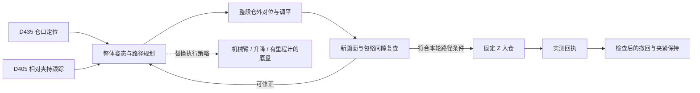

# 视觉入仓框架

目标是一次启动后连续完成视觉规划、姿态调整、仓外对位、复看纠偏、固定 Z 浅入及撤回，全程夹紧。当前实现位于独立分支 `codex/keep-grip-placement-20261116`，未改原工程，未推送。



## 已实现与边界

- `agent/visual_docking.py`：可运行协调器 `DockingRun(backend).run()`，带持久阶段回执、最多3次仓外纠偏、无进展停止、取消、驱动变更检查、帧与计划防重放、结果不确定时保持。没有松爪操作。
- `agent/docking_fit.py`：整个电池长方体包络穿过仓口的投影，含长电池对倾角的放大效应。分别给出名义间隙、误差扣除后的间隙。该模块只判断仓口投影；仓内全程、桌面、机械臂及夹爪扫掠必须由路径执行适配器检查。
- `agent/docking_grip.py`：逐帧追踪同一批 D405 特征、相对最初夹持坐标累计的双向光流与稳健相似变换，监测相对位移、转角、尺度及夹爪反馈变化；多个独立曝光稳定后才报告稳定。疑似滑动锁存，不自动换参考。图像只说明可见区域一致，不能证明夹持力或完整六维姿态。
- `scripts/preview-visual-docking.py`：真实 GET-only 规划适配器，复用现有 D435 红框/CAD 定位、TCP、IK、时间参数化、全臂负载扫掠，输出实拍叠加路径、完整 JSON 和网页。不会创建 ROS 控制器或 SDK，不申请硬件控制权。

已接入现有机械臂轨迹、升降目标与停止接口，以及带真实导航位姿反馈的底盘执行接口；没有重新初始化电机 SDK。任务入口为 `/visual-docking.html` 和 `/api/visual-docking`。机械臂先单独翻转 J6 至 -90°，随后调平、抬高避桌、仓外对位、复看纠偏，入仓段保持 Z，目标浅入 5mm、硬保护 10mm，完成后撤回；全程没有松爪操作。

实机证据须单独记录：此前一次升降实际上升约 5.5mm 后，因错误沿用 8 秒等待窗而中止；现场确认停稳、无下滑或异响、夹持稳固后，已保存恢复证据，只更换网页观察进程。等待窗改为 30 秒，未提高速度、增益或力矩。随后一次任务在规划期间由用户提出先翻转 J6，已取消，未产生运动。改为先单独 J6 翻转后的真实任务 `c3d5b4a07272489a956764c9f9884159`，J6 实际转到约 -71.05°，其余关节与升降基本保持原位；D405 有效夹持证据不足，发送 `arm.stop` 并收到保留关节保持目标与夹爪目标的确认。尚未完成 -90° 翻转、仓外对位或入仓。禁止把 `groups_moved=[]` 误读为没有真实运动，该字段目前只记录成功完成的运动组。

## 后端协议

后端是同一服务进程中的可信代码，不能直接用浏览器提交的字典充当“检查通过”的计划。

| 方法 | 职责 |
|---|---|
| `observe()` | 返回独立曝光的 `id,captured_at,driver_id,grip_stable,outside,at_entry,fit`；`fit` 含 `qualified_fit,available_clearance_mm`。在完成运动之后重新拍摄，不能拿旧图换 ID。 |
| `plan(phase, observation, reverse_of=None)` | 返回整段已检查的计划；机械臂、底盘或升降由 `strategy` 选择。包含 ID、图像/驱动绑定、扫掠检查、实测反馈能力、持续时间、固定 Z 和 `gripper_action='retain'`。 |
| `execute(plan, check_cancel)` | 同一次任务控制权下执行整段轨迹并持续复查传感器、碰撞范围和取消；返回对应计划/驱动 ID、实测完成、夹爪未释放和内外位置回执。不能把“下发成功”当成到位。 |
| `hold()` | 请求保持当前安全状态并保留夹爪目标。不得重新写零、松爪、重启驱动或以新的测量目标偷偷解除承载补偿。 |
| `cancelled()` | 与图像识别是否成功无关，随时能中断。 |

允许 `align` 的整体计划覆盖最多300秒的若干已检查子段；`insert/withdraw` 最多60秒，禁止升降参与，固定 Z。实际轨迹速度由已有低层限制，不由这个时间上界提高。

复杂 IK 可以预计算并缓存；执行适配器在返回计划前需用新画面和实测起姿重新验证缓存路径，并将 `observation_id` 绑定到该最新有效观察。协调器拒绝规划耗尽图像新鲜度后直接执行。轨迹执行期间，后端仍必须持续检查新鲜反馈、源文件/标定身份、夹持变化与取消；协调器不能替低层完成这些工作。

`align` 也可交给已适配的升降或底盘执行器；每次只运行一个运动组，完成后重新观察。底盘参与时必须有真实位移/姿态反馈和带载整机扫掠检查；缺少里程计时不能用“速度×时间”冒充定位。底盘入仓同样遵守固定 Z 与已检查的撤回路线，不能绕过仓口几何。

## 当前实拍规划结论

模型仓口净口 169.6×79mm，电池厚75mm，总名义竖向余量4mm。当前倾斜红框对应目标的名义最小余量约0.75mm，另保留0.5mm计划余量。TCP已有最大枢轴标定残差约4.18mm，D435外参和夹持姿态还有未量化误差，因此“名义包络能通过”不能等价于真实可靠通过。

用户允许试验可用于实测误差，但不能把上述不确定度删除后声称已经精确对准。下一步实机接入要先处理已知支撑/固定是否妨碍运动、当前夹爪零位异常，以及相机看到的真实姿态；不再重启携带电池的 SDK，因为其构造时会主动回零。

## 验证与使用

在已有独立仓库环境运行：

```sh
OPENBLAS_NUM_THREADS=1 PYTHONDONTWRITEBYTECODE=1 \
  /home/arx/arx-competition-control/.venv/bin/python -m unittest agent.tests.test_visual_docking

OPENBLAS_NUM_THREADS=1 PYTHONDONTWRITEBYTECODE=1 \
  /home/arx/arx-competition-control/.venv/bin/python scripts/preview-visual-docking.py
```

第二个入口只读取当前三相机系统中的 D435、D405 和控制反馈，不启动机器人。输出在 `reports/visual-docking-live/`。单元测试和实拍路径规划是不同证据，均不能替代真实负载执行验证。


## 红线不闭合时的自动拟合（已部署）

`agent/cabinet_red_edges.py` 在闭环红框识别失败时，直接采集可见红线的内缘过渡点，用稳健直线拟合四边并延长求交。四边不要求首尾像素连通；每边记录支持点数、覆盖跨度及90%残差，多候选不擅自选择，完全缺失的边不会凭空当成已测量边。当前电池遮住下边中段的实拍仍可恢复四角，边残差约0.6～0.8像素。拟合框继续进入同一CAD/PnP和负载路径检查，不改变夹爪、驱动、碰撞余量或入仓深度。

实机新证据：任务 `2262ad8c56fa4ddf8a46e19794b953de` 已完成 J6 约-89°与仓外高位对齐，D405连续跟踪有效，后续因红框被电池遮挡而停止。拟合版部署后，任务 `8e9d023402c94578848b0d03865936e5` 成功识别该遮挡仓口并继续仓外对位；实际运动中桌面间隙检查报9.76mm低于10mm，已收到保持关节参考与夹爪目标的停止确认，未入仓、未松爪。已请求现场确认本次停稳与无碰擦。原 `groups_moved` 只记录成功完成组，不能把空列表解读为没有部分实际运动。

静态间隙检查另发现：同一姿态重复点仍扣除1mm“采样点之间运动”的裕量，会低估静止几何距离。独立目录中已添加回归并修正这一计算；运动路径仍保留原连续采样上界。该修正尚未部署，不据此自动恢复运动。
